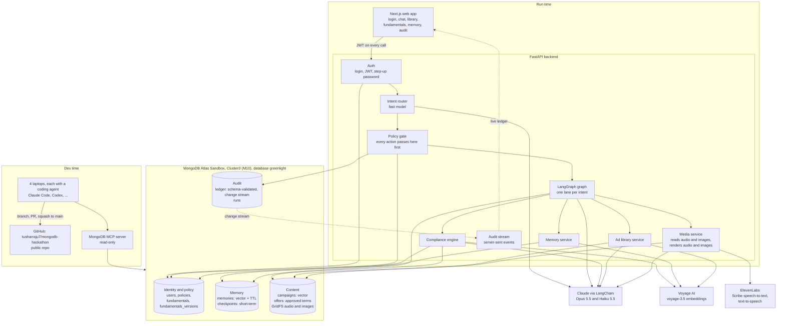

# Architecture

## Tech stack

| Layer | Choice | Notes |
|---|---|---|
| Web app | Next.js (App Router, client components), Tailwind | Pages: login, chat, library, fundamentals, memory, audit |
| Backend | Python 3.11+, FastAPI | One service, port 8000 |
| Agent | An explicit LangGraph graph: route → lane | The model classifies the intent; code checks the role and runs the lane. No tool schemas are sent to the model. See [BACKEND.md](BACKEND.md) |
| LLM | LangChain `init_chat_model` | `LLM_MODEL` (compliance verdict), `LLM_FAST_MODEL` (router, Q&A, extraction, drafting). Anthropic only: `anthropic:claude-opus-5-5` and `anthropic:claude-haiku-5-5`. Structured output uses the native JSON-schema method, since these models reject forced tool choice and sampling parameters |
| Embeddings | Voyage AI `voyage-3.5`, 1024 dimensions | `input_type="document"` on write, `"query"` on search. Frozen for the whole team |
| Database | MongoDB Atlas Sandbox, `Cluster0` (M10, MongoDB 9.0), database `greenlight` | Identity, policy, audit, memory and content all live here |
| Vector search | Atlas `$vectorSearch` with pre-filters | Three indexes: fundamentals, campaigns, memories |
| Short-term memory | LangGraph `MongoDBSaver` checkpointer | One thread per conversation |
| Audio in and out | ElevenLabs Scribe speech-to-text to review audio ads; ElevenLabs text-to-speech to regenerate a compliant audio ad and to produce the seeded samples | Stock voices only |
| Image in and out | The fast model with image input reads an image ad's text and describes it; a brand template rendered in code (Pillow) produces a regenerated image | No image-generation model: fine print must be exact |
| Media storage | GridFS in the same database | Every laptop sees the same files; no separate file store |
| Auth | Seeded users, bcrypt, JWT (HS256) | Step-up: password re-entered on every fundamentals or team-memory change |
| Live audit | Change stream on `ledger` → server-sent events | Powers the live ledger panel and the Stop button |
| MCP | MongoDB MCP server, read-only | Wired into each teammate's coding agent; optional runtime analytics tool (P2) |

## Infrastructure



## Core mechanism 1: policy gate and ledger

`backend/app/core/gate.py` is the only path by which a tool or router may act.

```
guarded(identity, action, params, run_id, fn, undo=None)
  1. runs.status == "stop_requested"?             → write `stop` event, raise RunStopped
  2. action in policies[identity.role].actions?   → else write `decision: deny`, raise Denied
  3. write `decision: allow` (policy refs with versions, memories_used)
  4. result = fn()
  5. write `outcome` (result summary, undo descriptor, tokens)
```

- **Before, not after.** The decision event is written before `fn()` runs. A denied action never executes.
- **In code, not in the prompt.** The model only classifies what was asked. Whether the role may do it is decided by step 2, in code, from the `policies` collection.
- **Append-only by design.** The ledger is a stream of events (`decision`, `outcome`, `stop`, `rollback`). Application code only inserts; nothing is updated in place. A `$jsonSchema` validator rejects events with no actor, action or timestamp. Database-enforced immutability (an insert-only role) is a P2 task; do not claim it until it ships.
- **Approval is bound to versions.** An approval records the ad version, the policy versions and the offer version that were reviewed. Release goes through the gate and is refused if any of them has changed since.
- **Reconstructable.** All events of one request share a `run_id`; sorting them by time replays the run with who, what, which policy versions, which memories, and the result.
- **Stoppable.** `POST /runs/{id}/stop` sets `runs.status = "stop_requested"`. The next `guarded()` call in that run stops. Stop takes effect between steps; a call to an outside service that is already in flight is not cancelled.
- **Reversible.** Each outcome stores an undo descriptor. `POST /runs/{id}/rollback` replays them in reverse: a fundamental is restored to its previous version; a memory change is reverted (the new memory forgotten, the superseded one reactivated); a submitted ad is marked `rolled_back`. Rollback undoes our own records; it does not undo an external call. Each undo writes a `rollback` event.

## Core mechanism 2: governed memory

`backend/app/services/memory.py`.

- **Scoped read.** `recall()` is a `$vectorSearch` on `memories_vec` with pre-filter `status = active`, `scope.team = identity.team`, `visibility_roles` contains the caller's role; then `expires_at` is null or in the future, and `scope.user_id` is null or the caller. One team's memory cannot reach another team's prompt because the database never returns it.
- **Lifetime.** A TTL index on `expires_at` removes expired memories. Queries also filter on `expires_at`, so expiry is immediate even before the TTL monitor runs.
- **Correction.** `correct()` writes a new memory that links `supersedes` to the old one and marks the old one `superseded`. History is kept.
- **Forgetting.** `forget()` sets `status = forgotten`. It is no longer retrievable; the ledger shows who forgot it and why.
- **All writes are gated.** `remember`, `correct` and `forget` go through `guarded()`, so memory changes are in the ledger with an identity. Team-scoped changes require step-up authentication.
- **Proof of behaviour change.** Ids of recalled memories are recorded on the ledger (`memories_used`) and shown as chips on the reply. "Replay without memory" reruns the same prompt with `use_memory=false` for a side-by-side comparison.

### Memory types

| Type | Stored in | Marketing example | Lifetime | Written by |
|---|---|---|---|---|
| Short-term | `checkpoints` | The current conversation; "the ad" means the last ad discussed | Thread | LangGraph checkpointer |
| Semantic | `fundamentals`, `memories` (kind `semantic`) | Policy clauses such as "do not promise guaranteed approval"; team facts such as "the Quebec team runs radio in French only" | Clauses: their effective dates. Facts: until corrected | Manager (clauses, team facts); marketer (own notes) |
| Episodic | `memories` (kind `episodic`) | "A national email ad was blocked for 'Guaranteed approval'; the version saying 'Subject to credit approval' was approved" | 30 days | The agent, after each review |
| Procedural | `memories` (kind `procedural`) | "Quebec card ads must include 'Sous réserve de l'approbation du crédit.'" | Until corrected | Manager instruction or reject feedback |

### Policy and memory are separate

Policy clauses in `fundamentals` are the authority: versioned, with a source section, a status and effective dates. Memories are what the team has told the agent and what happened before. Memory can add a team instruction or show how a similar case was settled; it cannot waive a clause. Every finding says which one it rests on: a policy key and version, the offer record, or a memory id.

### Offers are the system of record

The approved terms of a promotion (rates, bonus, conditions, fee) live in `offers`. The agent compares an ad's numbers with the offer in code, and answers questions from the offer. It never supplies a term that is not in the ad or the offer; with no offer record it stops and asks.

## Confidence, feedback and reasoning

Every verdict comes with a summary, a confidence score for the verdict, and for each finding its reasoning, the evidence compared and its own confidence. Checks that passed are listed too.

- **Computed, not self-reported.** The score is arithmetic in code over the evidence: whether the finding came from a deterministic check, whether its policy is mandatory for the claim, whether its quote is in the ad word for word, how the judge labelled it (clear, likely, unclear), whether a past verdict agrees, and how the ad was read (typed text, transcript or image).
- **A guard against invented quotes.** A finding whose quoted words are not in the ad is dropped before scoring.
- **Stricter only.** An unclear finding, or a pass that is not high confidence, goes to human review. Confidence never turns a finding into a pass and never replaces an approval.
- **Recorded.** The verdict's score is written to the ledger with the outcome.
- **What it is not.** It is a measure of evidence strength with starting weights, not a calibrated probability.

The formula is in [CONTRACTS.md](CONTRACTS.md); a worked calculation is in [WORKED_EXAMPLE.md](WORKED_EXAMPLE.md).

## Media in and out

An ad can be text, audio or an image. The review always runs on text, so every form is first turned into text and that text is stored on the ad.

| Form | In (for review) | Out (regenerated version) | Out (retrieved for a question) |
|---|---|---|---|
| Text | Used as is | The corrected copy | The text |
| Audio | ElevenLabs Scribe → transcript | ElevenLabs text-to-speech of the corrected script | The audio file, with a player |
| Image | Vision model → all on-image text plus visual notes | Corrected copy rendered on the brand template, in code | The image |

- **Check before rendering.** Regeneration reviews the corrected copy first and renders only copy that passes, with at most one repair attempt. If it does not pass, nothing is produced.
- **A new rendering, not an edit.** A regenerated audio or image carries the corrected copy; the original recording or artwork is kept as the earlier version.
- **Why a template for images.** Image-generation models cannot be relied on to reproduce a rate or a line of fine print exactly. Rendering text in code makes the output identical to the reviewed copy.
- **One way to find any ad.** Every ad has a text `description` of what a customer would remember, and that is what is embedded and searched. Audio and image ads are found the same way as text ads and returned as their file.
- **Read once.** A transcript or image reading is stored on the ad and reused. The file is not sent to a model again.

## Flow of one request

The three use cases (review existing creative, memory updates, questions about an ad) are diagrammed in [FLOWS.md](FLOWS.md), and one credit card ad is followed end to end in [WORKED_EXAMPLE.md](WORKED_EXAMPLE.md). The shared spine:

1. **Identify** — JWT → `{user, role, team}` from `users`; a `runs` document is opened.
2. **Route** — fast model classifies the intent among the ones this role may use.
3. **Gate** — `guarded()` checks the stop flag and the RBAC matrix, and writes the decision.
4. **Recall and retrieve** — scoped vector search on `memories`, `fundamentals` or `campaigns`.
5. **Act** — review, update or answer.
6. **Record** — outcome event, memory write if any, reply with cards.

## Why this is not "basic RAG" or a dashboard

The agent takes actions with side effects: it transcribes audio and reads images, checks an ad's numbers against the offer record, issues a verdict and route, files the ad version in the library, regenerates a compliant version as text, audio or image after checking it, and changes policy and memory under step-up authentication. Release of an ad is a gated action that is refused when the approval no longer matches current versions. Retrieval is one input to those actions, and the audit and memory screens exist to review and correct what the agent did.

Review and Q&A on their own would look like retrieval. The demo therefore leads with the block, the regenerated version, the approval, the release check and the authorised memory change. Image reading is one input among three and is never the headline: "image analyzers" are on the event's banned list.
