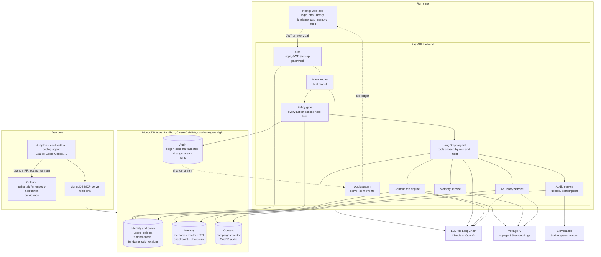

# Architecture

## Tech stack

| Layer | Choice | Notes |
|---|---|---|
| Web app | Next.js (App Router, client components), Tailwind | Pages: login, chat, library, fundamentals, memory, audit |
| Backend | Python 3.11+, FastAPI | One service, port 8000 |
| Agent | LangGraph prebuilt tool-calling agent | Tools are built per request from the caller's role and the routed intent |
| LLM | LangChain `init_chat_model` | `LLM_MODEL` (compliance verdict), `LLM_FAST_MODEL` (router, Q&A, extraction, drafting). Defaults: `anthropic:claude-opus-5-5` and `anthropic:claude-haiku-5-5`. Teammates with OpenAI keys set `openai:<model>` |
| Embeddings | Voyage AI `voyage-3.5`, 1024 dimensions | `input_type="document"` on write, `"query"` on search. Frozen for the whole team |
| Database | MongoDB Atlas Sandbox, `Cluster0` (M10, MongoDB 9.0), database `greenlight` | Identity, policy, audit, memory and content all live here |
| Vector search | Atlas `$vectorSearch` with pre-filters | Three indexes: fundamentals, campaigns, memories |
| Short-term memory | LangGraph `MongoDBSaver` checkpointer | One thread per conversation |
| Audio | ElevenLabs Scribe speech-to-text, to review audio ads; ElevenLabs text-to-speech to produce the seeded sample ads | Audio stored in GridFS so every laptop sees the same assets |
| Auth | Seeded users, bcrypt, JWT (HS256) | Step-up: password re-entered on every fundamentals or team-memory change |
| Live audit | Change stream on `ledger` → server-sent events | Powers the live ledger panel and the Stop button |
| MCP | MongoDB MCP server, read-only | Wired into each teammate's coding agent; optional runtime analytics tool (P2) |

## Infrastructure



## Core mechanism 1: policy gate and ledger

`backend/app/core/gate.py` is the only path by which a tool or router may act.

```
guarded(identity, action, params, run_id, fn, undo=None)
  1. runs.status == "stop_requested"?             → write `stop` event, raise RunStopped
  2. action in policies[identity.role].actions?   → else write `decision: deny`, raise Denied
  3. write `decision: allow` (policy refs with versions, memories_used)
  4. result = fn()
  5. write `outcome` (result summary, undo descriptor, tokens)
```

- **Before, not after.** The decision event is written before `fn()` runs. A denied action never executes.
- **In code, not in the prompt.** A sales user's agent is never handed `update_memory` or `review_creative`. If a tool were called anyway, step 2 denies it.
- **Append-only.** The ledger is a stream of events (`decision`, `outcome`, `stop`, `rollback`). Nothing is updated in place. A `$jsonSchema` validator rejects events with no actor, action or timestamp.
- **Reconstructable.** All events of one request share a `run_id`; sorting them by time replays the run with who, what, which policy versions, which memories, and the result.
- **Stoppable.** `POST /runs/{id}/stop` sets `runs.status = "stop_requested"`. The next `guarded()` call in that run stops.
- **Reversible.** Each outcome stores an undo descriptor. `POST /runs/{id}/rollback` replays them in reverse: a fundamental is restored to its previous version; a memory change is reverted (the new memory forgotten, the superseded one reactivated); a submitted ad is marked `rolled_back`. Each undo writes a `rollback` event.

## Core mechanism 2: governed memory

`backend/app/services/memory.py`.

- **Scoped read.** `recall()` is a `$vectorSearch` on `memories_vec` with pre-filter `status = active`, `scope.team = identity.team`, `visibility_roles` contains the caller's role; then `expires_at` is null or in the future, and `scope.user_id` is null or the caller. One team's memory cannot reach another team's prompt because the database never returns it.
- **Lifetime.** A TTL index on `expires_at` removes expired memories. Queries also filter on `expires_at`, so expiry is immediate even before the TTL monitor runs.
- **Correction.** `correct()` writes a new memory that links `supersedes` to the old one and marks the old one `superseded`. History is kept.
- **Forgetting.** `forget()` sets `status = forgotten`. It is no longer retrievable; the ledger shows who forgot it and why.
- **All writes are gated.** `remember`, `correct` and `forget` go through `guarded()`, so memory changes are in the ledger with an identity. Team-scoped changes require step-up authentication.
- **Proof of behaviour change.** Ids of recalled memories are recorded on the ledger (`memories_used`) and shown as chips on the reply. "Replay without memory" reruns the same prompt with `use_memory=false` for a side-by-side comparison.

### Memory types

| Type | Stored in | Marketing example | Lifetime | Written by |
|---|---|---|---|---|
| Short-term | `checkpoints` | The current conversation; "the ad" means the last ad discussed | Thread | LangGraph checkpointer |
| Semantic | `fundamentals`, `memories` (kind `semantic`) | Company rules such as "do not say Product of Canada"; team facts such as "the Quebec team runs radio in French only" | Until corrected | Manager (rules, team facts); marketer (own notes) |
| Episodic | `memories` (kind `episodic`) | "A national ad was blocked for 'Product of Canada'; 'Roasted in Canada from imported beans' was approved" | 30 days | The agent, after each review |
| Procedural | `memories` (kind `procedural`) | "Quebec audio ads must end with 'Torréfié au Québec'" | Until corrected | Manager instruction or approve/reject feedback |

## Flow of one request

The three use cases (review existing creative, memory updates, questions about an ad) are diagrammed in [FLOWS.md](FLOWS.md). The shared spine:

1. **Identify** — JWT → `{user, role, team}` from `users`; a `runs` document is opened.
2. **Route** — fast model classifies the intent among the ones this role may use.
3. **Gate** — `guarded()` checks the stop flag and the RBAC matrix, and writes the decision.
4. **Recall and retrieve** — scoped vector search on `memories`, `fundamentals` or `campaigns`.
5. **Act** — review, update or answer.
6. **Record** — outcome event, memory write if any, reply with cards.

## Why this is not "basic RAG" or a dashboard

The agent takes actions with side effects (transcribes audio, issues verdicts that admit or block creative, files ads in the library, changes policy and memory). Retrieval is one input to a gated action, and the audit and memory screens exist to review and correct what the agent did.
