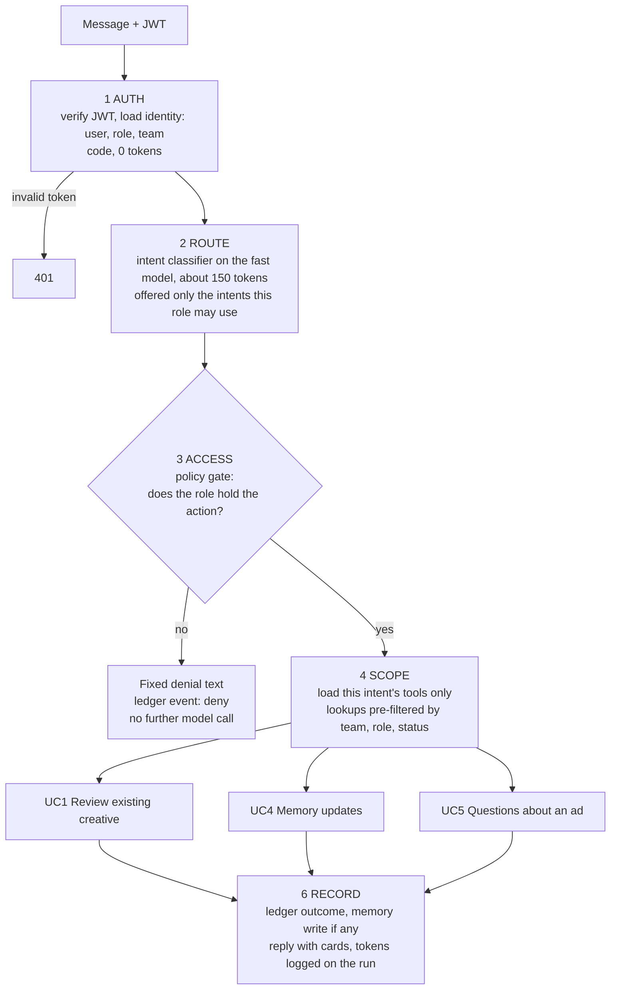
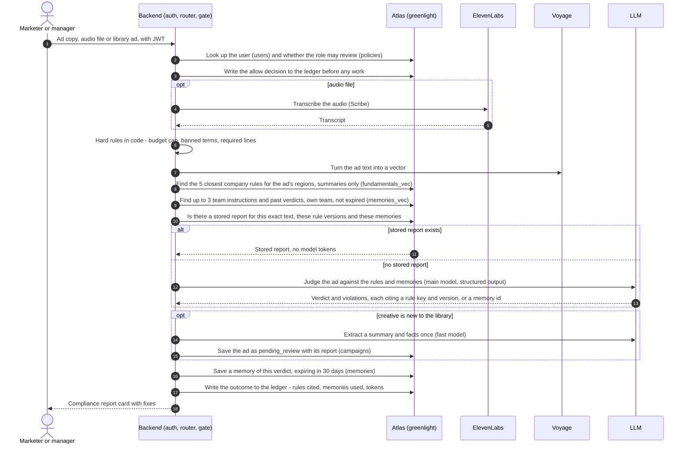
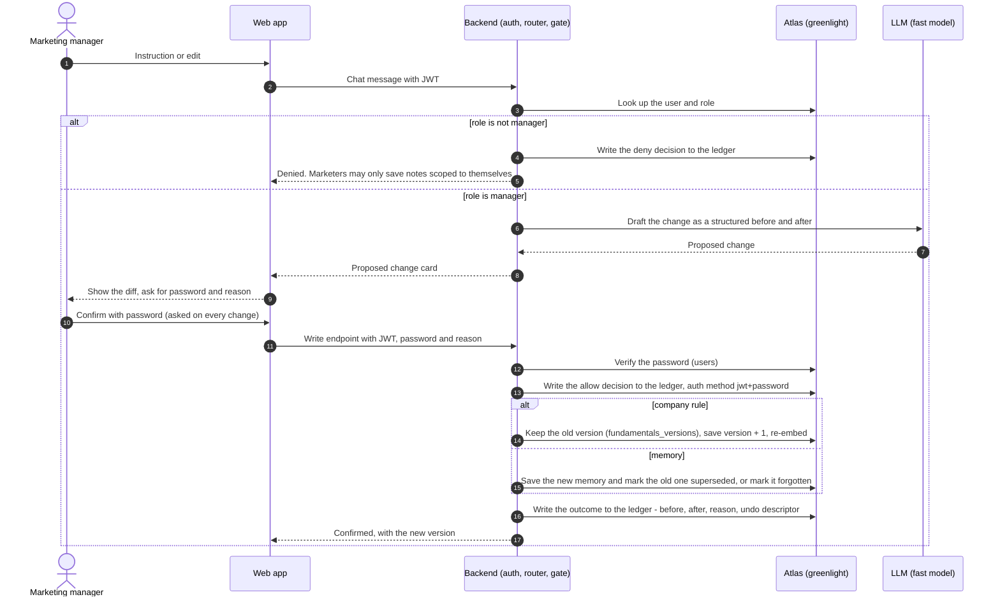
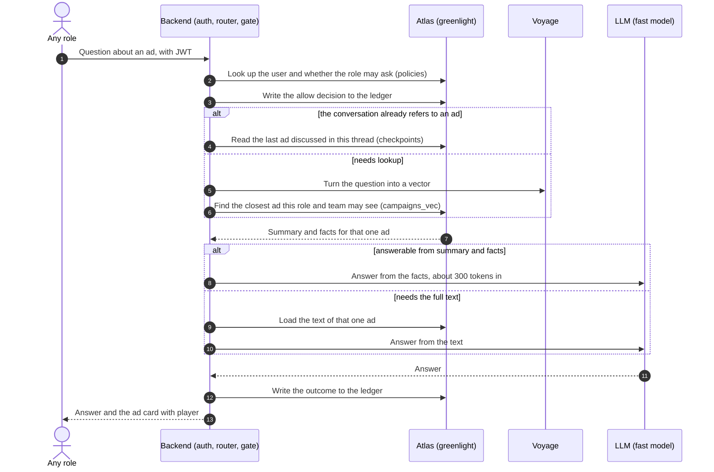

# Operational flows

Three use cases, in build priority order. For each: the flow, how it authenticates, what memory it reads and writes, and how it keeps token use low.

> UC2 (create new creative from a prompt) and UC3 (compare campaigns) were dropped from scope. The remaining ids are kept as UC1, UC4, UC5.

**Setting.** Solstice Coffee Co. is a fictional Canadian coffee roaster with two marketing teams: `national` (English Canada) and `quebec`. Ads carry a region: `CA` or `CA-QC`. A Quebec ad is checked against global rules, Canadian rules and Quebec rules; a national ad against global and Canadian rules.

**Roles.** `manager` = marketing manager (the approved person), `marketer`, `sales`.

## Access matrix

| Use case | manager | marketer | sales | Step-up password |
|---|---|---|---|---|
| UC1 Review existing creative | yes | own team | no | no |
| UC4 Memory updates | yes | personal notes only | no | every change |
| UC5 Questions about an ad | yes | yes | approved ads only | no |

## Front door (shared by every use case)

| Intent | Action checked at the gate | Tools loaded |
|---|---|---|
| `review` | `compliance.check` (and `campaign.submit` when the creative is saved) | `review_creative` |
| `memory_update` | `fundamentals.update`, `memory.write`, `memory.forget` | `update_memory`, `forget_memory`, `review_fundamentals` |
| `ask` | `campaign.ask` | `ask_about_ad` |

## UC1 — Existing creative review

A marketer or manager pastes ad copy, uploads an audio ad (ElevenLabs Scribe transcribes it), or names an ad already in the library.

Example: a national ad that says *"Solstice. Canada's best coffee. 100% Product of Canada."* with a CAD 50,000 budget is blocked on three counts: an unsupported superlative, an origin claim coffee cannot meet (the fix offered is "Roasted in Canada from imported beans"), and a budget over the team cap.

- **Authentication:** JWT. Role must hold `compliance.check`. A library ad must belong to the caller's team.
- **Memory read:** semantic (the company rules), procedural (the manager's standing instructions for this team), episodic (past verdicts on similar ads).
- **Memory written:** episodic, expiring in 30 days.
- **Tokens:** hard rules and both lookups cost no model tokens; a stored report skips the judge; the judge sees five rule summaries and three short memories; summary and facts are extracted once and reused by UC5.

## UC4 — Memory updates by the marketing manager

Covers: a new standing instruction, editing a company rule, correcting a memory, forgetting a memory.

Example: the Quebec manager says *"From now on, Quebec audio ads must end with 'Torréfié au Québec'."* The next review of a Quebec audio ad without that line is flagged, citing this instruction.

The agent only drafts the change. The password goes from the browser straight to the write endpoint and never passes through the model.

- **Authentication:** JWT plus password re-entry for every single change. The ledger records `auth.method = jwt+password`. Sales cannot write. Marketers can save notes with `scope.user_id` set to themselves, without step-up.
- **Memory read:** the item being changed.
- **Memory written:** semantic (company rules, team facts) and procedural (standing instructions). Old versions are kept.
- **Tokens:** one small drafting call on the fast model. The write, versioning and re-embedding are code.

## UC5 — General questions about an ad

Also handles "I heard an ad about …": the agent returns the ad itself.

Example: a sales rep asks *"I heard an ad about slow mornings at Union Station, what's the offer in it?"* and gets the approved ad with its player, plus the answer.

- **Authentication:** JWT. All roles. Sales are limited to approved ads of their own team by the query filter, so an unapproved ad can never be returned to them.
- **Memory read:** short-term (the conversation) to resolve "the ad".
- **Memory written:** none.
- **Tokens:** one ad, facts first, full text only when needed, fast model.

## Token rules (apply to every flow)

1. **Deny before spending.** Authentication and role checks are code. A refused request costs at most the router call.
2. **One intent, one small tool set.** The model never sees tool schemas for flows the role or the intent does not need.
3. **Filter before retrieving.** Team, role, region and status are filters inside the vector search. Out-of-scope documents cost nothing and cannot leak.
4. **Summaries, not documents.** `summary` (60 words or fewer) and `facts` are computed once at write time. Full text is loaded only for the item being cited or edited. Embeddings are never returned.
5. **Fixed lookup budgets.** Company rules 5, memories 3, ads 1.
6. **Code before model.** Hard rules, diffs and versioning are code.
7. **Model tiering.** The main model is used only for the compliance verdict. Router, Q&A, extraction and drafting use the fast model.
8. **Reuse verdicts.** Reports are stored under a key built from the ad text, the versions of the rules consulted and the ids of the memories recalled. Any change to those produces a fresh verdict.
9. **Trim the conversation.** The last 6 turns plus a rolling summary go to the model. Full history stays in `checkpoints`.
10. **Measure.** `intent` and `tokens.in` / `tokens.out` are logged on every `runs` document and shown in the audit view.
