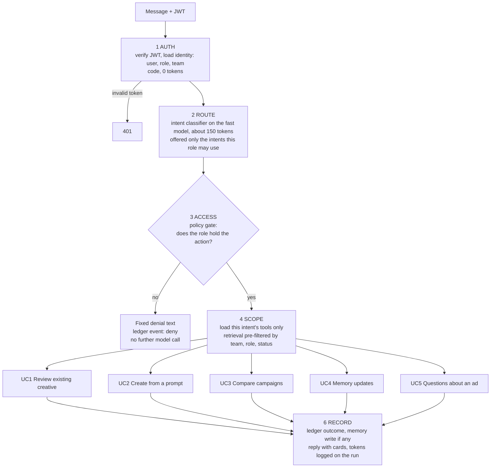
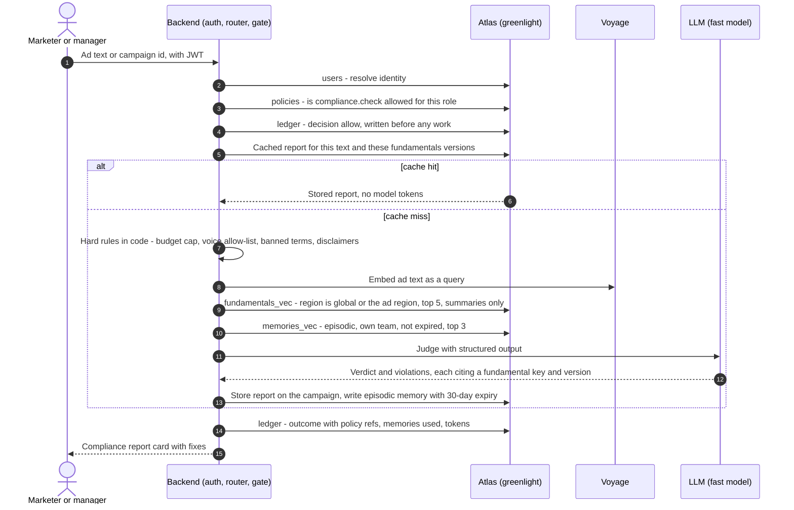
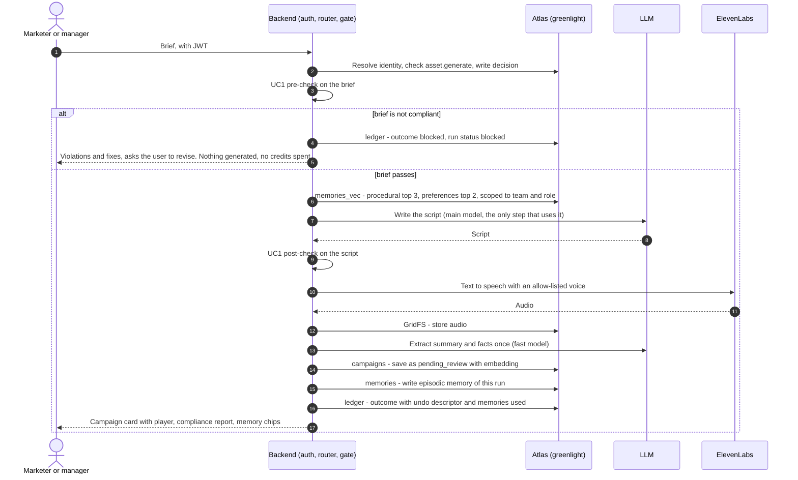
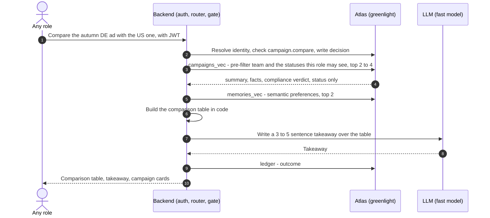
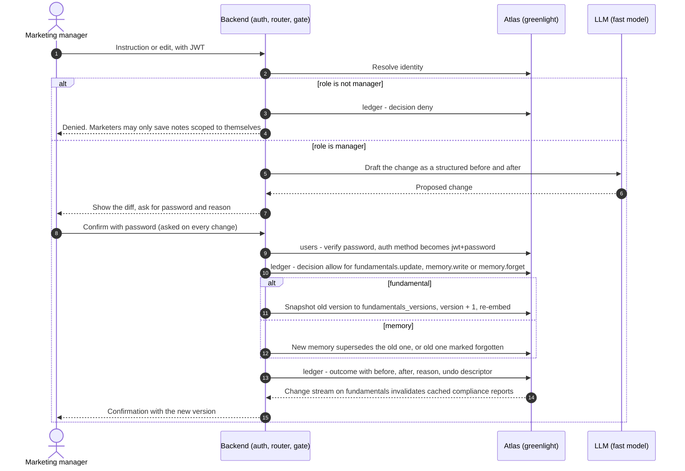
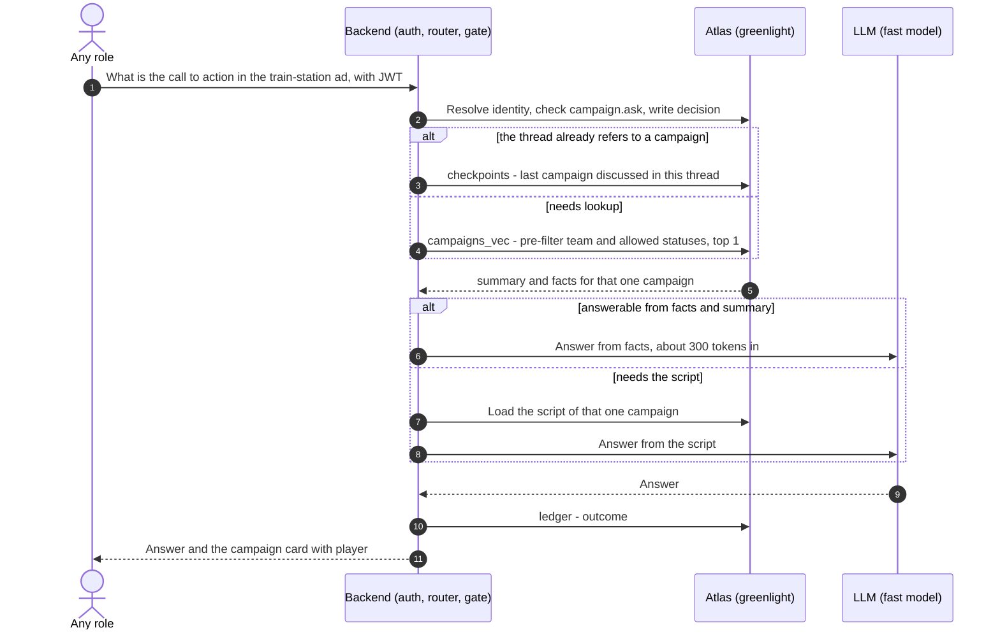

# Operational flows

Five use cases, in build priority order. For each: the flow, how it authenticates, what memory it reads and writes, and how it keeps token use low.

Roles: **manager** = marketing manager (the approved person), **marketer**, **sales**.

## Access matrix

| Use case | manager | marketer | sales | Step-up password |
|---|---|---|---|---|
| UC1 Review existing creative | yes | own team | no | no |
| UC2 Create from a prompt | yes | yes | no | no |
| UC3 Compare campaigns | yes | yes | approved only | no |
| UC4 Memory updates | yes | personal notes only | no | every change |
| UC5 Questions about an ad | yes | yes | approved only | no |

## Front door (shared by every use case)

| Intent | Action checked at the gate | Tools loaded |
|---|---|---|
| `review` | `compliance.check` | `review_creative` |
| `create` | `asset.generate` | `generate_ad`, `review_creative` |
| `compare` | `campaign.compare` | `compare_campaigns` |
| `memory_update` | `fundamentals.update`, `memory.write`, `memory.forget` | `update_memory`, `forget_memory`, `review_fundamentals` |
| `ask` | `campaign.ask` | `ask_about_ad` |

## UC1 — Existing creative review

A marketer or manager pastes an ad, names a stored campaign, or (P1) uploads audio that ElevenLabs Scribe transcribes.

- **Authentication:** JWT. Role must hold `compliance.check`. A stored campaign must belong to the caller's team.
- **Memory read:** semantic (fundamentals), episodic (past verdicts on similar ads).
- **Memory written:** episodic, expiring in 30 days.
- **Tokens:** cache hit costs nothing; hard rules run in code first; the judge sees five summaries and three short memories; fast model.

## UC2 — New creative from a prompt

- **Authentication:** JWT. Role must hold `asset.generate` (manager, marketer). Each step is a separate gated action, so the stop flag is honoured between steps.
- **Memory read:** procedural (how this team wants ads written), semantic preferences. Their ids are recorded as `memories_used`.
- **Memory written:** episodic.
- **Tokens:** a blocked brief costs one judge call; the main model is used once; summary and facts are extracted once and reused by UC3 and UC5.

## UC3 — Comparing current campaigns

- **Authentication:** JWT. Manager and marketer see all statuses of their own team. Sales see `approved` only. The status filter is in the query.
- **Memory read:** semantic preferences (what this team cares about when comparing).
- **Memory written:** none.
- **Tokens:** about 100 tokens per campaign (stored facts) instead of full scripts; the table is code; no embeddings are ever returned.

## UC4 — Memory updates by the marketing manager

Covers: a new standing instruction ("from now on DE audio ads end with the recycling line"), editing a fundamental, correcting a memory, forgetting a memory.

- **Authentication:** JWT plus password re-entry for every single change. The ledger records `auth.method = jwt+password`. Sales cannot write. Marketers can save notes with `scope.user_id` set to themselves, without step-up.
- **Memory read:** the item being changed.
- **Memory written:** semantic (fundamentals, team facts) and procedural. Old versions are kept.
- **Tokens:** one small drafting call. The write, versioning and re-embedding are code.

## UC5 — General questions about an ad

Also handles "I saw an ad about …": the agent returns the ad itself.

- **Authentication:** JWT. All roles. Sales are limited to approved campaigns of their team by the query filter.
- **Memory read:** short-term (thread) for reference resolution.
- **Memory written:** none.
- **Tokens:** one document, facts first, script only when needed, fast model.

## Token rules (apply to every flow)

1. **Deny before spending.** Authentication and RBAC are code. A refused request costs at most the router call.
2. **One intent, one small tool set.** The model never sees tool schemas for flows the role or the intent does not need.
3. **Filter before retrieving.** Scope lives in the `$vectorSearch` pre-filter. Out-of-scope documents cost nothing and cannot leak.
4. **Summaries, not documents.** `summary` (60 words or fewer) and `facts` are computed once at write time. Full text is loaded only for the item being cited or edited. Embeddings are never projected.
5. **Fixed retrieval budgets.** Fundamentals 5, memories 3, campaigns 4.
6. **Code before model.** Hard rules, comparison tables and diffs are computed in code.
7. **Model tiering.** The main model writes scripts. Router, judge, Q&A and extraction use the fast model.
8. **Cache compliance reports** by hash of the content plus the versions of the fundamentals consulted.
9. **Trim short-term memory.** The last 6 turns plus a rolling summary go to the model. Full history stays in `checkpoints`.
10. **Measure.** `intent` and `tokens.in` / `tokens.out` are logged on every `runs` document and shown in the audit view.
