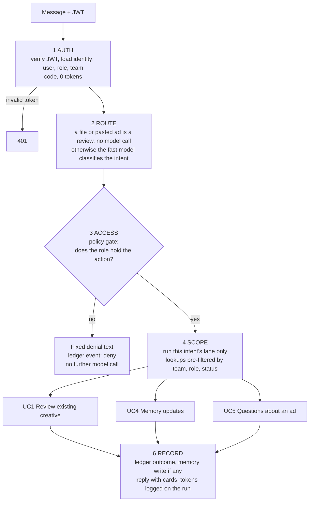
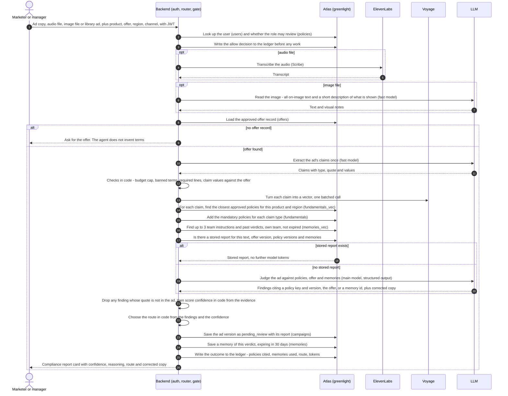
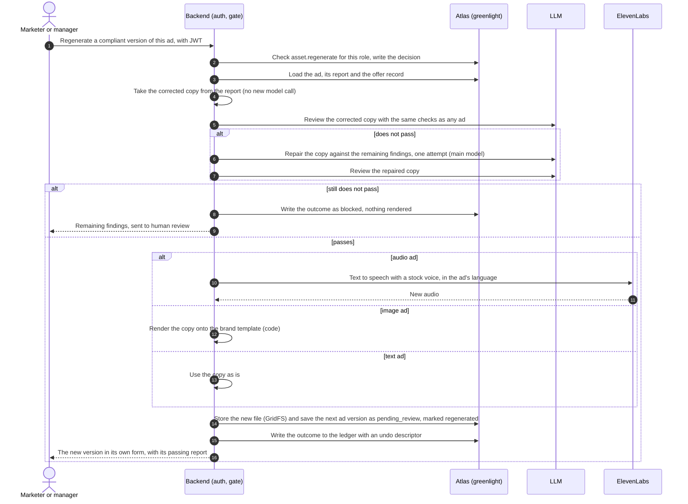
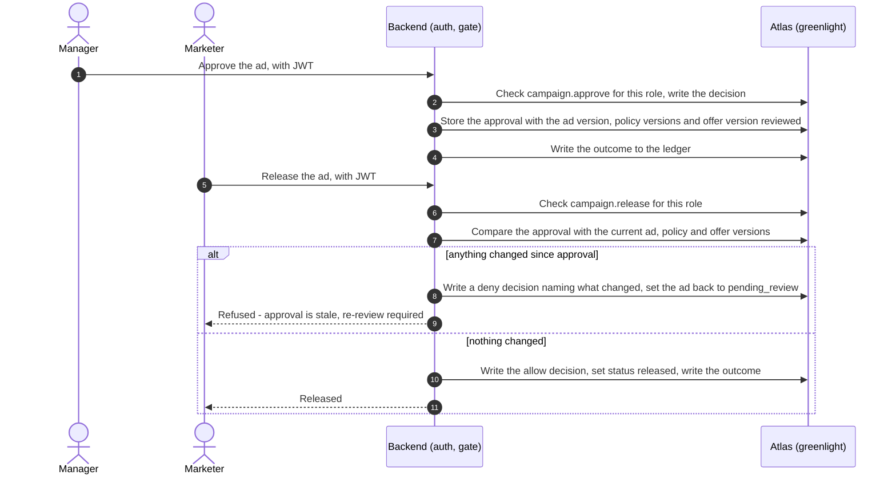
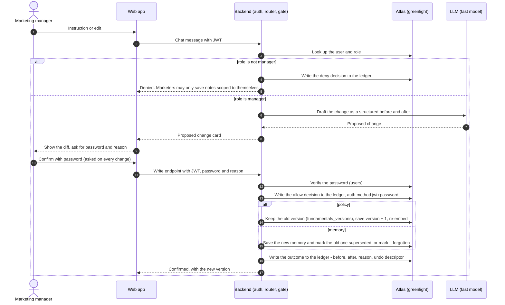
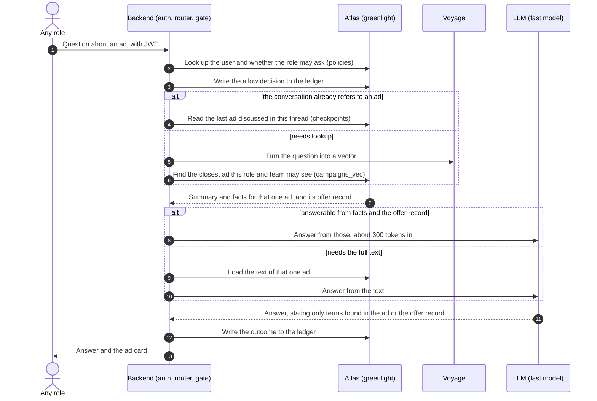

# Operational flows

> **Archived: bank example.** Written before the switch to NorthPlay. The mechanisms still match the code; the names, rules, users and offers do not. The access and token rules below are current. For the system as built, read [BACKEND.md](BACKEND.md).

Three use cases, in build priority order. For each: the flow, how it authenticates, what memory it reads and writes, and how it keeps token use low. A full worked example with sample JSON is in [WORKED_EXAMPLE.md](WORKED_EXAMPLE.md).

> UC2 (create new creative from a blank prompt) and UC3 (compare campaigns) were dropped from scope. The remaining ids are kept as UC1, UC4, UC5. Regenerating a compliant version of a reviewed ad is part of UC1.

**Media.** An ad can be text, audio or an image, both going in and coming out. Audio is transcribed and images are read into text before review; a regenerated version and a retrieved ad come back in the ad's own form.

**Setting.** Tamarack Bank is a fictional Canadian bank advertising the Tamarack Cashback Card. Two marketing teams: `national` (English Canada) and `quebec`. Ads carry a region, `CA` or `CA-QC`, a product, and the id of the approved offer they promote. A Quebec ad is checked against global, Canadian and Quebec policies; a national ad against global and Canadian policies.

**Roles.** `manager` = marketing manager (the approved person, who also approves ads), `marketer`, `sales` (branch and call-centre staff).

## Access matrix

| Use case | manager | marketer | sales | Step-up password |
|---|---|---|---|---|
| UC1 Review existing creative | yes | own team | no | no |
| UC1 Regenerate a compliant version | yes | own team | no | no |
| UC1 Approve a reviewed ad | yes | no | no | no |
| UC1 Release an approved ad | yes | own team | no | no |
| UC4 Memory updates | yes | personal notes only | no | every change |
| UC5 Questions about an ad | yes | yes | released ads only | no |

## Front door (shared by every use case)

| Intent | Action checked at the gate | Tools loaded |
|---|---|---|
| `review` | `compliance.check`, `campaign.submit` when the ad is saved, `asset.regenerate` when a new version is produced | `review_creative`, `regenerate_creative` |
| `memory_update` | `fundamentals.update`, `memory.write`, `memory.forget` | `update_memory`, `forget_memory`, `review_fundamentals` |
| `ask` | `campaign.ask` | `ask_about_ad` |

Approve and release are buttons in the ad library, not chat intents. They call their own endpoints and pass through the same gate (`campaign.approve`, `campaign.release`).

## UC1 — Existing creative review

A marketer or manager pastes ad copy, uploads an audio ad (ElevenLabs Scribe transcribes it), uploads an image ad (a vision model reads all on-image text, including fine print, and describes what is shown), or names an ad already in the library. Product, offer, region, channel and budget are chosen in the form, not guessed by the model.

Example: *"Guaranteed approval! Enjoy 0% interest for 12 months and earn $300 cash back. Apply today."* is blocked and routed to human review. It promises approval, states 12 months where the approved offer says 10, and omits the later rate, the bonus conditions and the required lines. The agent drafts corrected copy.

### Review

Routing is a business rule on the findings, never a similarity threshold:

| Findings include | Route | Verdict |
|---|---|---|
| A material conflict, an offer mismatch, or missing evidence | `human_review` | `blocked` |
| Only missing disclosures that have an approved fix | `draft_correction` | `needs_changes` |
| Only formatting or brand wording | `auto_correct` | `needs_changes` |
| Nothing | `none` | `pass` |

Two further rules can only make the route stricter: a finding the judge labels `unclear` goes to human review, and so does a pass whose confidence is not high.

In this build the route is recorded and shown; every ad still needs a manager's approval before release.

### Confidence, feedback and reasoning

Every report carries a confidence score for the verdict and one for each finding, with the reasons behind the number.

| Part of the report | What it contains |
|---|---|
| Summary | Up to three plain sentences: the verdict and why |
| Verdict confidence | A score from 0 to 100, a band (high, medium, low) and the reasons |
| Each finding | The quote from the ad, the policy and version (or offer field, or memory) it rests on, a two-sentence reasoning, the evidence compared, the fix, and its own confidence |
| What passed | The checks that found nothing wrong, such as "bonus amount matches the offer" |
| Route | Where it goes next and the rule that sent it there |

How the score is built:

- **The number is computed in code, not asked of the model.** The judge only labels each of its findings `clear`, `likely` or `unclear`.
- **A finding scores higher when** it comes from a check in code (budget, required line, offer mismatch), its policy is mandatory for the claim made, its quote is found word for word in the ad, the judge called it clear, and a past verdict agrees.
- **A finding scores lower when** it rests only on a similarity match, the judge was unsure, or the ad was read from audio or an image rather than typed text.
- **A quote that is not in the ad removes the finding.** This guards against the judge citing words the ad never used.
- **For a pass, confidence is about coverage:** whether every claim in the ad had an applicable policy to be checked against, and how cleanly the ad was read.
- **For a block, one solid finding is enough:** the verdict's confidence is that of its strongest deciding finding.

The score measures how strong the evidence is. It is not a probability that the verdict is right, and it never loosens anything: it cannot turn a finding into a pass, skip an approval or approve an ad. The exact weights are in [CONTRACTS.md](CONTRACTS.md).

### Regenerate a compliant version

Offered on any report that is not a pass. The corrected copy is checked first; only copy that passes is rendered, so nothing non-compliant is ever produced and no ElevenLabs credits are spent on it. The result comes back in the ad's own form.

- A regenerated version is a new recording or a new rendering that carries the corrected copy. It is not an edit of the original file.
- Images are rendered from a brand template in code, not by an image-generation model, so rates and fine print appear exactly as approved.
- "Compliant" here means it passes the same review as any other ad. It still needs a manager's approval and passes through the release check.
- Regeneration is not possible while the offer record is missing.

### Approve and release

- **Authentication:** JWT. Review needs `compliance.check`; a library ad must belong to the caller's team. Regeneration needs `asset.regenerate`. Approval needs `campaign.approve` (manager). Release needs `campaign.release`.
- **Memory read:** semantic (the policies), procedural (the manager's standing instructions for this team), episodic (past verdicts on similar ads). Policy is authoritative; memory can add an instruction but cannot waive a policy.
- **Memory written:** episodic, expiring in 30 days.
- **Tokens:** one fast-model extraction, reused by UC5; code checks and lookups cost no model tokens; a stored report skips the judge; the judge sees short policy summaries and at most three memories.

## UC4 — Memory updates by the marketing manager

Covers: a new standing instruction, editing a policy, correcting a memory, forgetting a memory.

Example: the Quebec manager says *"From now on, Quebec card ads must include the line 'Sous réserve de l'approbation du crédit.'"* The next review of a Quebec ad without that exact line is flagged, citing this instruction.

The agent only drafts the change. The password goes from the browser straight to the write endpoint and never passes through the model.

A policy edit has a visible consequence: any ad approved against the old version can no longer be released until it is reviewed again (see Approve and release above).

- **Authentication:** JWT plus password re-entry for every single change. The ledger records `auth.method = jwt+password`. Sales cannot write. Marketers can save notes with `scope.user_id` set to themselves, without step-up.
- **Memory read:** the item being changed.
- **Memory written:** semantic (policies, team facts) and procedural (standing instructions). Old versions are kept.
- **Tokens:** one small drafting call on the fast model. The write, versioning and re-embedding are code.

## UC5 — General questions about an ad

Also handles "a customer saw an ad about …": the agent returns the ad itself, in its own form: the image, the audio with a player, or the text. Ads of every form are found the same way, by the stored description of what a customer would remember.

Example: a branch advisor asks *"A customer got an email about 300 dollars cash back on the card. What are the conditions?"* and gets the released ad plus the conditions from its stored facts and the offer record.

- **Authentication:** JWT. All roles. Sales are limited to released ads of their own team by the query filter, so an unreleased ad can never be returned to them.
- **Confidence:** each answer says where it came from (the ad and version, the offer and version, which fields) and carries a band: high when every term comes from the offer record or the ad's stored facts, medium when the full text was needed, low when the ad and offer do not answer the question, in which case the agent says so.
- **Memory read:** short-term (the conversation) to resolve "the ad".
- **Memory written:** none.
- **Tokens:** one ad, facts first, full text only when needed, fast model.

## Token rules (apply to every flow)

1. **Deny before spending.** Authentication and role checks are code. A refused request costs at most the router call.
2. **One intent, one lane.** The model classifies the intent and code runs the lane. No tool schemas are sent to the model at all.
3. **Filter before retrieving.** Team, role, product, region, status and effective dates are filters inside the vector search. Out-of-scope documents cost nothing and cannot leak.
4. **Summaries, not documents.** `summary` (60 words or fewer) and `facts` are computed once at write time. Full text is loaded only for the item being cited or edited. Embeddings are never returned.
5. **Fixed lookup budgets.** Policies: 2 per claim plus the mandatory ones, at most 8 in total. Memories 3. Ads 1.
6. **Code before model.** Hard rules, offer matching, routing, the release check, diffs and versioning are code.
7. **Model tiering.** The main model is used only for the compliance verdict and, when needed, one repair of corrected copy. Router, claim extraction, image reading, Q&A and drafting use the fast model.
8. **Extract once.** The claims extracted during review are stored as the ad's `facts` and reused by every later question.
9. **Reuse verdicts.** Reports are stored under a key built from the ad text, the offer version, the versions of the policies consulted and the ids of the memories recalled. Any change to those produces a fresh verdict.
10. **Trim the conversation.** The last 6 turns plus a rolling summary go to the model. Full history stays in `checkpoints`.
11. **Measure.** `intent` and `tokens.in` / `tokens.out` are logged on every `runs` document and shown in the audit view.
12. **Regenerate only on request, and check before rendering.** The corrected copy already exists in the report. It is reviewed before any audio or image is produced, with one repair attempt at most.
13. **Read media once.** A transcript or image reading is stored on the ad and reused; the file is never sent to a model again.
14. **Reasoning is short and written once.** Two sentences per finding and three for the summary, produced in the single judge call and stored with the report. Confidence is arithmetic in code and costs no tokens.
